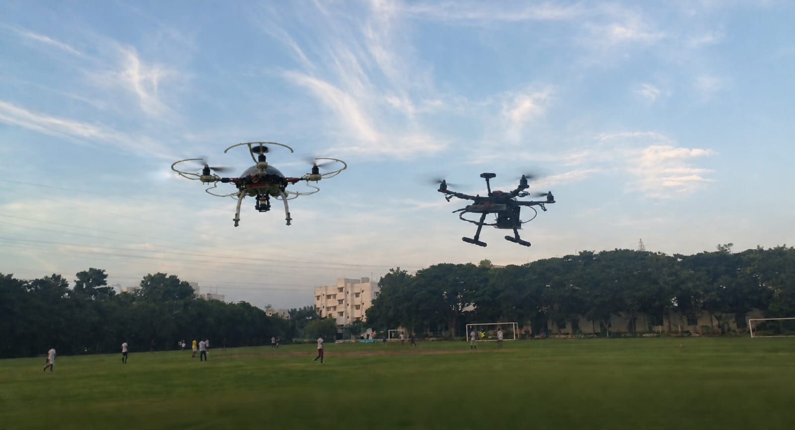
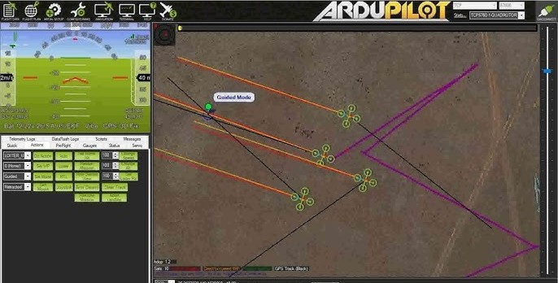
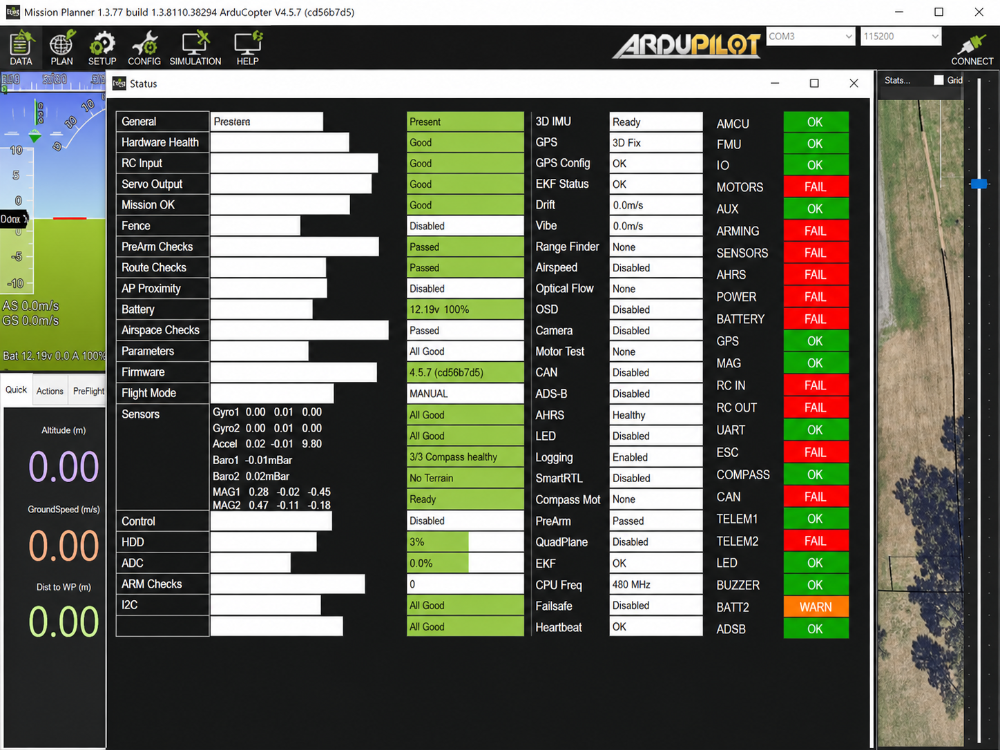
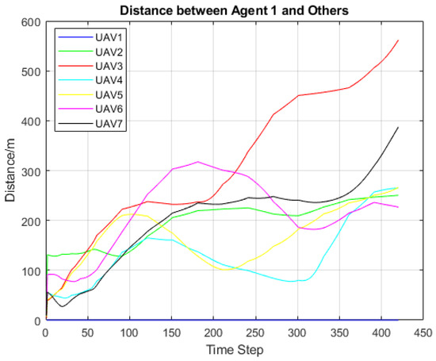
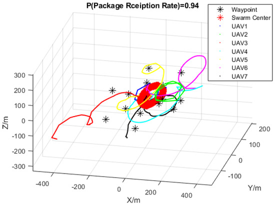

# Sky Recon — Resilient Networking Robots

Sky Recon coordinates mobile robots that restore local connectivity when ordinary infrastructure is unavailable, overloaded, or unreliable. Robots can reposition as relay nodes, evaluate changing links, route traffic across multiple hops, and carry priority messages until a destination becomes reachable again.

<p align="center">
  
</p>

The platform combines resilient networking with safe robot motion. It is transport-neutral: deployments can connect locally permitted Wi-Fi, LoRa, private LTE, Ethernet, or experimental-radio adapters without coupling the routing engine to one vendor. It is intended for disaster response, remote operations, temporary events, and authorized infrastructure recovery—not unauthorized spectrum use or interference with other networks.

## What the robot network provides

- Multi-hop routing that automatically favors healthier relay paths.
- Store-and-forward delivery when parts of the network are temporarily isolated.
- Priority handling so emergency messages survive constrained buffer capacity.
- Link monitoring based on loss, latency, signal strength, capacity, and freshness.
- Mobile-relay positioning between disconnected field teams.
- Coordinated missions, predictive separation, emergency landing, and event auditing.
- Adapter boundaries for radios and flight controllers, keeping policy and hardware replaceable.

## Quick start

```bash
python -m pip install -e ".[test]"
pytest
```

```python
import asyncio

from skyrecon import (
    EventJournal,
    LinkReport,
    MeshMessage,
    MeshTopology,
    Mission,
    MissionCoordinator,
    Vector3,
)
from skyrecon.adapters import SimulatedVehicle


async def survey():
    # Route local traffic through the healthiest available robot relays.
    mesh = MeshTopology()
    mesh.update(LinkReport("base", "relay-1", -61, 18, 0.01, 900))
    mesh.update(LinkReport("relay-1", "field-team", -68, 35, 0.04, 420))
    print(mesh.path("base", "field-team"))

    emergency = MeshMessage("field-team", "base", b"medical supplies requested", priority=10)

    # Move a relay robot while the networking layer remains transport-neutral.
    control = MissionCoordinator(EventJournal("mission-events.db"))
    control.register(SimulatedVehicle("relay-1"))
    await control.connect()
    final = await control.fly(
        "relay-1",
        Mission("restore-field-link", Vector3(north=40, east=15, down=-12)),
    )
    print(emergency.message_id, final)


asyncio.run(survey())
```

## Architecture

- `models.py` defines immutable vectors, telemetry, modes, and missions.
- `networking.py` provides mesh routing, link health, priority buffering, and relay placement.
- `coordinator.py` owns asynchronous vehicle registration and mission execution.
- `safety.py` predicts near-future separation and modifies unsafe velocity commands.
- `routing.py` provides obstacle-aware grid routing.
- `journal.py` records operational events in SQLite.
- `adapters/` contains transport implementations; the included simulator is deterministic.

## Operational views

These reference views illustrate the mobile-network workflows Sky Recon is designed to support. Hardware-specific screens require appropriate vehicle and radio adapters; the core package remains independent of any single ground-control station, flight controller, or network transport.

### Mobile relay operations

Monitor networking robots, relay positions, active routes, and mission progress from a compatible operations console.



### Network and robot readiness

Review link quality, navigation confidence, power state, and safety checks before dispatching a relay robot.



### Cooperative coverage

Spread relay robots across a service area while the separation guard adjusts unsafe velocity commands.


### Link-distance analysis

Compare distance and link observations to evaluate coverage gaps and validate safe robot spacing.



### Deployment reconstruction

Mission journals, network reports, and robot telemetry can feed downstream coverage maps and three-dimensional deployment analysis.



## Safety boundary

Sky Recon is research software. It does not defeat jammers, guarantee internet access, or authorize operation on restricted spectrum. Hardware integrations must add authenticated and encrypted transports, rate limits, local spectrum compliance, flight-controller failsafes, regulatory geofencing, independent emergency controls, and scenario-specific validation. Simulation success does not establish airworthiness or radio compliance.

## License and provenance

Sky Recon is distributed under the MIT License. This implementation was independently structured for the Sky Recon project. The license file retains the notice from the earlier MIT-licensed project lineage as required.
